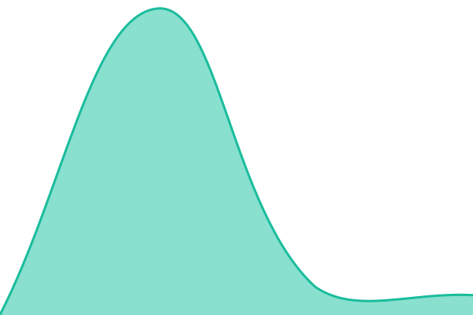

# [📈 Live Status](https://status.ohauthcat.com): <!--live status--> **🟥 Complete outage**

This repository contains the open-source uptime monitor and status page for [OhAuthCat](https://ohauthcat.com/), powered by [Upptime](https://github.com/upptime/upptime).

With [Upptime](https://upptime.js.org), you can get your own unlimited and free uptime monitor and status page, powered entirely by a GitHub repository. We use [Issues](https://github.com/ohauthcat/status/issues) as incident reports, [Actions](https://github.com/ohauthcat/status/actions) as uptime monitors, and [Pages](https://status.ohauthcat.com) for the status page.

<!--start: status pages-->
<!-- This summary is generated by Upptime (https://github.com/upptime/upptime) -->
<!-- Do not edit this manually, your changes will be overwritten -->
<!-- prettier-ignore -->
| URL | Status | History | Response Time | Uptime |
| --- | ------ | ------- | ------------- | ------ |
|  [Sign-in](https://auth.ohauthcat.com/healthz) | 🟥 Down | [sign-in.yml](https://github.com/ohauthcat/status/commits/HEAD/history/sign-in.yml) | 

 738ms
     
 | 

<a href="https://status.ohauthcat.com/history/sign-in">100.00%</a>
    

|  [Hosted sign-in pages](https://signin.ohauthcat.com/) | 🟥 Down | [hosted-sign-in.yml](https://github.com/ohauthcat/status/commits/HEAD/history/hosted-sign-in.yml) | 

 342ms
     
 | 

<a href="https://status.ohauthcat.com/history/hosted-sign-in">100.00%</a>
    

|  [SCIM](https://scim.ohauthcat.com/healthz) | 🟥 Down | [scim.yml](https://github.com/ohauthcat/status/commits/HEAD/history/scim.yml) | 

 751ms
     
 | 

<a href="https://status.ohauthcat.com/history/scim">100.00%</a>
    

|  [Management API](https://api.ohauthcat.com/healthz) | 🟥 Down | [management-api.yml](https://github.com/ohauthcat/status/commits/HEAD/history/management-api.yml) | 

 714ms
     
 | 

<a href="https://status.ohauthcat.com/history/management-api">100.00%</a>
    

|  [Dashboard](https://console.ohauthcat.com/) | 🟥 Down | [dashboard.yml](https://github.com/ohauthcat/status/commits/HEAD/history/dashboard.yml) | 

 401ms
     
 | 

<a href="https://status.ohauthcat.com/history/dashboard">100.00%</a>
    

|  [Setup portal](https://connect.ohauthcat.com/) | 🟥 Down | [setup-portal.yml](https://github.com/ohauthcat/status/commits/HEAD/history/setup-portal.yml) | 

 490ms
     
 | 

<a href="https://status.ohauthcat.com/history/setup-portal">100.00%</a>
    

<!--end: status pages-->

[**Visit our status website →**](https://status.ohauthcat.com)

## 📄 License

- Powered by: [Upptime](https://github.com/upptime/upptime)
- Code: [MIT](./LICENSE) © [Anand Chowdhary](https://anandchowdhary.com)
- Data in the `./history` directory: [Open Database License](https://opendatacommons.org/licenses/odbl/1-0/)
